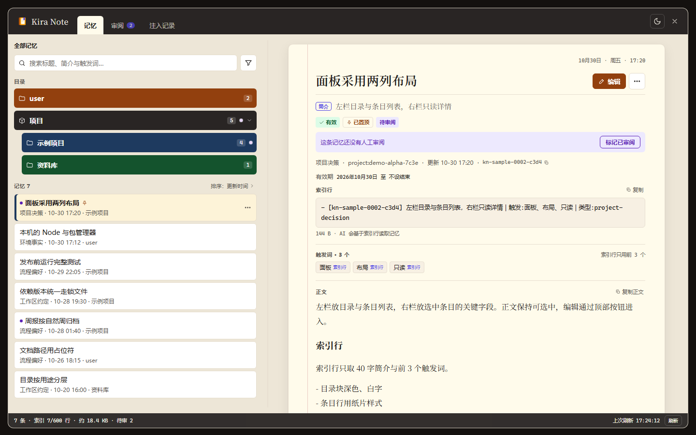

<p align="center"></p>
<h1 align="center">Kira Note</h1>

<p align="center">DeepSeek Harness 的长期记忆本：记忆存成本地 Markdown，模型每轮只读一小份快照，你在侧栏面板里审阅和修改。</p>

<p align="center"></p>

> 状态：当前版本 v0.1.0-alpha，本机桌面版可用，未发布到 npm。面板验收进度见「已知限制」，仍需真实环境下的进一步测试。

## 为什么用 Kira Note

会话结束后，项目约束、命名习惯、流程偏好这些长期事实要重新交代一遍。把它们塞进提示词，或者交给一个每轮全量注入的插件，结果是要么带着一堆用不上的条目，要么该消失的旧结论一直出现。

Kira Note 把这件事拆成三个可以分开检查的部分：

- **记什么**：写入前先过一份排除清单。代码模式、架构描述、git 历史、调试配方、本轮临时状态都不进库。
- **每轮带什么**：注入有硬上限；放不下全文的降级成一条索引行；被裁掉的条数写进快照，模型知道缺口在哪里。
- **谁来决定**：新条目默认待审，你在面板里逐条确认或归档。没有删除，只有取代、过期、归档与恢复。

## Kira Note 能做什么

| 面 | 内容 |
| --- | --- |
| 跨会话记忆 | 四个模型工具：`kira_recall` 检索、`kira_raw` 取原文、`kira_write` 写入、`kira_status` 改状态 |
| 两级作用域 | `user` 与 `project:<id>`。项目 id 由当前工作目录算出，换项目不串库 |
| 受控注入 | 每轮最多 25 条 / 25 KB；两侧各保底 10 条 / 10 KB，余量按同一排序在两池间竞争 |
| 生命周期 | `active / expired / superseded / archived` 四态；取代、过期、归档、恢复、置顶、标记已审 |
| 面板 | 目录 + 记忆列表 + 只读详情与编辑态、审阅队列、注入记录；键盘可完成全部操作 |
| 纯文件存储 | `~/.kira-note/` 下一条一个 Markdown 文件，可直接用编辑器打开，也可以用 git 管理 |

## 前置条件

- DSH（DeepSeek Harness）桌面版。宿主需要提供 `ctx.systemPrompt.context()`、`ctx.tools.register()`、`ctx.workingDirectory` 与 `dsh.client` 加载面。
- Node.js ≥ 18。插件没有运行时依赖，源码是纯 ESM。

## 安装

本包未在 npm 上发布，从本地目录装。`dsh plugin` 把参数原样转给 profile 目录里的 pnpm；装完声明了 `dsh.bundle` 的包会被追加进 `dsh.profile.bundles`，不用手改补丁层。

```sh
git clone <仓库地址> kira-note
DSH_CLI="<DSH 安装目录>/resources/runtime/cli/bin/dsh.cmd"
"$DSH_CLI" plugin --profile desktop add "$(pwd)/kira-note"
```

先完全退出 DSH 桌面版：这条路直接把参数交给 pnpm，不经过宿主那把 profile 写锁。`<DSH 安装目录>` 是应用安装位置，`dsh` 本身不在 PATH 上。下面 `<本地仓库目录>` 指克隆出来的 `kira-note` 文件夹；目标必须是绝对路径（pnpm 在 profile 目录里跑），`$(pwd)` 负责展开。

本地目录会记成 `"kira-note": "link:<本地仓库目录>"`，之后改源码不必重装。装完重启 `dsh`：`package.json` 里的 `dsh.bundle.patch` 指向 `cordis.patch.yml`，补丁在启动时加载。

在 DSH 会话里也可以用内置工具装，同样写 profile 依赖与 bundle 列表：

```
plugin_manager action=install_bundle target=<本地仓库目录>
```

### 升级

`link:` 指向仓库目录，替换源码后重启 `dsh` 即可，不必重跑 `add`。只改 `src/` 时先 `npm run build` 重新生成 `lib/client.js`。

不想重启就热重载一次，先置 `enabled:false` 再置 `enabled:true`：

```
plugin_manager action=set_plugin target=include:kira-note
```

### 卸载

```sh
DSH_CLI="<DSH 安装目录>/resources/runtime/cli/bin/dsh.cmd"
"$DSH_CLI" plugin --profile desktop remove kira-note
```

`remove` 同时删掉 profile 依赖与 bundle 列表里的那一行，重启后生效。`~/.kira-note/` 里的数据不会被动；要清空记忆就手动删除该目录。

## 第一次跑通

1. 重启后侧栏出现 Kira Note 图标，有未审阅条目时带一个小圆点。
2. 点开是两列面板：左栏是目录与记忆列表，右栏是选中条目的详情。
3. 在对话里说一条值得长期保留的事实，模型调用 `kira_write`；条目出现在 `~/.kira-note/` 下，索引多一行。
4. 下一轮对话的系统提示词里出现这段记忆；新条目在面板「审阅」页签里等你确认。

## 工具与接口

| 工具 | 参数 | 行为 |
| --- | --- | --- |
| `kira_recall` | `query`、`scope?`、`include_history?`、`limit?`（默认 8，上限 25） | BM25 全库检索，返回 id、标题、简介、分数与全文；默认只返回生效条目，归档条目始终不返回 |
| `kira_raw` | `id` | 按 id 返回原文与 frontmatter，任何状态都可读 |
| `kira_write` | `title`、`summary`、`body`、`type`、`triggers?`、`scope_suggestion?`、`valid_until?` | 结构校验后落盘；同作用域内标题重复会被拒绝并返回已有 id |
| `kira_status` | `id`、`action`、`new_id?` | `supersede`（需 `new_id`）/ `expire` / `archive` / `restore` / `pin` / `unpin` / `review` |

条目类型五类：`environment-fact`、`process-preference`、`persona-language`、`workspace-convention`、`project-decision`。

`summary` 与 `title` 同用 40 字上限；`triggers` 最多存 10 个，索引行只显示前 3 个。

## 配置

插件没有配置文件。可改的只有记忆库位置：

| 项 | 默认 | 说明 |
| --- | --- | --- |
| `~/.kira-note/` | 家目录下 | 记忆库位置 |
| `KIRA_NOTE_HOME` | 未设置 | 环境变量覆盖库位置，测试与多库切换用 |
| `config.home` | 未设置 | 挂载时传入的库位置，优先于环境变量 |

## 数据在哪

```
~/.kira-note/
  user/entries/<id>.md              user/INDEX.md
  projects/<project-id>/entries/<id>.md
  projects/<project-id>/INDEX.md
  projects.json                     id → { path, name, gitRemote?, created }
  events.jsonl                      条目事件，追加不改写
  injection-journal.jsonl           每次注入快照变化一行
  boot-errors.log                   挂载失败时追加
```

条目是 YAML frontmatter 加 Markdown 正文。三项上限各自独立：每作用域 500 条、索引每作用域 200 行、每轮注入 25 条 / 25 KB。

插件不做网络请求，不跑后台定时任务，没有遥测。记忆正文可以用任意编辑器打开，可以用 git 版本化。

## 它怎么工作

三面共用一个磁盘库：

- **注入**：`ctx.systemPrompt.context({ order: 1000, required: true, interpolate: false })`，每轮把「功能说明 + 选中条目 + 缺口提示」写进系统提示词。内容不变时逐字返回同一份文本，宿主按整文本判重。
- **工具**：四个工具和面板写入走同一套核心函数，写入路径只有一条。
- **面板**：Host 半经 Typert Remote 暴露 7 个端点（snapshot / detail / write / update / status / move / injectionLog），Client 半挂 `sidebar.panellist` 行与 `main` 面板。

选取顺序：`pinned 降序 → 规则类 type（persona-language、process-preference）优先 → updated 降序 → id 升序`。索引按 type 分节，小类先拿够，余量给最大的类。

检索是 BM25 全扫，不建倒排索引：本机 6,184 条语料实测 3.8–4.3 ms/次（2026-11-07，两轮，抖动约 ±10%）。耗时不在检索，在每轮注入的体积。

## 已知限制

- 只有 `user` 与 `project` 两级作用域，模块级作用域未实现。
- 没有删除。状态只有四态，物理删除要在文件系统里做。
- 面板功能已实现，尚未按验收清单逐项点验；装机后的点开、新建、编辑、撤销还没有验收记录。
- 未发布 npm，没有版本化迁移；升级靠替换仓库目录。
- 检索是词面匹配（中文按字、英文按词）。查询词与条目用词完全不重叠时取不到，需要换关键词再试一次。
- 单个作用域 500 条封顶，满了要先归档旧条目。
- dsh web / headless 未测。

## 排障

| 现象 | 处理 |
| --- | --- |
| 装完没生效 | 补丁在启动时加载，重启 `dsh`；确认 profile 的 bundle 列表里有 `kira-note` |
| 侧栏没有图标 | 看 `~/.kira-note/boot-errors.log`。client 面加载失败不影响工具与注入 |
| 条目写了但没注入 | 用 `kira_status` 查状态；过期、被取代、归档的条目不进默认注入 |
| 状态栏显示「跳过 N 条坏数据」 | 有条目文件的 frontmatter 读不动，按提示修文件或归档 |
| 索引满 | 每作用域 200 行，归档旧条目后索引在下次写入时重建 |

## 开发

```sh
npm test        # node --test test/ —— 34 个用例
npm run build   # src/ → lib/client.js
```

- `lib/*.js`（`client.js` 除外）是手写源码，零依赖 ESM，Node 18 直接加载。
- `src/` 是面板源码；`lib/client.js` 是构建产物，不要直接改。
- 宿主专有包 `@deepseek-ai/*` 只在 DSH 里由 loader 解析，本地 node 进程直接 import 会报 `ERR_MODULE_NOT_FOUND`，所以 tools / service / client 走宿主内实测。

## 许可证

MIT，见 [LICENSE](LICENSE)。
